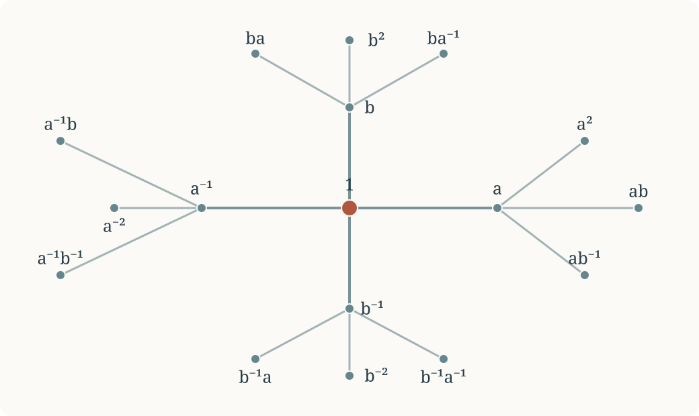

<!-- ml:collection:group-theory -->

<!-- ml:block:b001 -->
# Свободные группы. Образующие и соотношения

<!-- ml:block:b002 -->
Свободная группа формализует слова из заданного алфавита, в которых разрешено сокращать лишь соседние взаимно обратные буквы. Затем мы научимся задавать группы, добавляя к свободной группе соотношения, и разберём, как доказывать корректность таких заданий.

<!-- ml:block:b003 -->
## 1. Слова и свободная группа

<!-- ml:block:b004 -->
Пусть $X$ — множество символов, называемых **образующими**. Для каждого $x\in X$ введём новый символ $x^{-1}$; множество этих символов обозначим $X^{-1}$. **Слово** — конечная последовательность букв из $X\sqcup X^{-1}$. Допускается **пустое слово** $1$.

<!-- ml:block:b005 -->
Разрешим **элементарное сокращение** $xx^{-1}\mapsto 1$ и $x^{-1}x\mapsto 1$ в любом месте слова, а также обратные операции — вставки таких пар. Два слова называются **эквивалентными**, если одно получается из другого конечной последовательностью этих операций. Слово **приведённое** (или **несократимое**), если в нём нет соседних взаимно обратных букв.

<!-- ml:block:b006 -->
::: {.theorem}
**Теорема о приведённом слове.** Каждый класс эквивалентности слов содержит ровно одно приведённое слово.
:::

<!-- ml:block:b007 -->
<!-- ml:fold-start title="Доказательство" open="false" -->

<!-- ml:block:b008 -->
Если $u$ — приведённое слово, а $c$ — буква, обозначим через $T_c(u)$ результат приписывания $c$ справа и сокращения последней пары, если она стала взаимно обратной. Отображения $T_c$ и $T_{c^{-1}}$ взаимно обратны.

<!-- ml:block:b009 -->
Будем читать произвольное слово слева направо, начиная с пустого слова и последовательно применяя $T_c$ для каждой его буквы $c$. После каждого шага получаем приведённое слово, эквивалентное уже прочитанному, поэтому в каждом классе есть приведённый представитель. Вставка или удаление соседней пары $cc^{-1}$ не меняет результата: соответствующие два отображения взаимно обратны. Значит, результат зависит только от класса эквивалентности. Для приведённого слова алгоритм ничего не сокращает, поэтому результат совпадает с самим словом. Следовательно, два эквивалентных приведённых слова равны.

<!-- ml:block:b010 -->
<!-- ml:fold-end -->

<!-- ml:block:b011 -->
::: {.definition}
**Определение.** **Свободная группа** $F(X)$ — множество классов эквивалентности слов с умножением, заданным приписыванием слов друг к другу. Единица — класс пустого слова; обратное к $x_1\cdots x_n$ представлено словом $x_n^{-1}\cdots x_1^{-1}$.
:::

<!-- ml:block:b012 -->
Эквивалентность сохраняется при приписывании слов слева и справа, поэтому операция корректна. Ассоциативность следует из ассоциативности приписывания. Теорема позволяет отождествлять элементы $F(X)$ с приведёнными словами.

<!-- ml:block:b013 -->
Например, $F(\varnothing)=\{1\}$, $F(\{x\})\cong\mathbb Z$, а $F(\{x,y\})$ некоммутативна: приведённые слова $xy$ и $yx$ различны.

<!-- ml:block:b014 -->
## 2. Универсальное свойство

<!-- ml:block:b015 -->
::: {.theorem}
**Универсальное свойство.** Для любой группы $G$ и любого отображения $f\colon X\to G$ существует единственный гомоморфизм $\overline f\colon F(X)\to G$, совпадающий с $f$ на $X$.
:::

<!-- ml:block:b016 -->
<!-- ml:fold-start title="Доказательство" open="false" -->

<!-- ml:block:b017 -->
На словах гомоморфизм вынужден задаваться формулой $\overline f(x_1^{\varepsilon_1}\cdots x_n^{\varepsilon_n})=f(x_1)^{\varepsilon_1}\cdots f(x_n)^{\varepsilon_n}$. Вставка или удаление взаимно обратной пары не меняет произведения, так что отображение определено на классах эквивалентности. Оно является гомоморфизмом и единственно, поскольку $X$ порождает $F(X)$.

<!-- ml:block:b018 -->
<!-- ml:fold-end -->

<!-- ml:block:b019 -->
::: {.theorem}
**Единственность свободной группы.** Если группы $F$ и $F'$ снабжены отображениями $i\colon X\to F$, $i'\colon X\to F'$ и обе обладают указанным универсальным свойством, то существует единственный изоморфизм $F\to F'$, переводящий $i(x)$ в $i'(x)$ при всех $x\in X$.
:::

<!-- ml:block:b020 -->
<!-- ml:fold-start title="Доказательство" open="false" -->

<!-- ml:block:b021 -->
Универсальное свойство даёт гомоморфизмы $u\colon F\to F'$ и $v\colon F'\to F$, продолжающие соответствующие отображения $X$. Композиции $vu$ и $uv$ тождественны на образах $X$, поэтому по единственности продолжения равны тождественным гомоморфизмам.

<!-- ml:block:b022 -->
<!-- ml:fold-end -->

<!-- ml:block:b023 -->
Если требовать, чтобы принимающая группа была **абелевой**, получится свободная абелева группа на $X$:
$$
\mathbb Z^{(X)}=\bigoplus_{x\in X}\mathbb Z.
$$
Её элементы — целочисленные формальные линейные комбинации элементов $X$ с конечным носителем. Универсальное свойство формулируется так же, но только для абелевых групп. Кроме того,
$$
F(X)_{\mathrm{ab}}=F(X)/[F(X),F(X)]\cong\mathbb Z^{(X)}.
$$

<!-- ml:block:b024 -->
## 3. Граф Кэли свободной группы

<!-- ml:block:b025 -->
::: {.definition}
Пусть $G$ порождена множеством $X$. **Граф Кэли** $\Gamma(G,X)$ имеет вершины $g\in G$ и ориентированное ребро $(g,x)$ из $g$ в $gx$ для каждого $g\in G$ и $x\in X$. При переходе к неориентированному графу сохраняем разные рёбра, даже если у них совпадают концы, и петли. Так мы не теряем информацию о соотношениях $x^2=1$ или $x=y^{-1}$.
:::

<!-- ml:block:b026 -->
::: {.proposition}
**Утверждение.** Граф $\Gamma(F(X),X)$, рассматриваемый без ориентации, является деревом. Обратно, если $X$ порождает $G$ и $\Gamma(G,X)$ — дерево, то $G$ свободна с базисом $X$.
:::

<!-- ml:block:b027 -->
<!-- ml:fold-start title="Доказательство" open="false" -->

<!-- ml:block:b028 -->
Связность следует из того, что $X$ порождает группу. Путь из единицы кодируется словом из $X\sqcup X^{-1}$; немедленное возвращение по ребру соответствует сокращению соседней пары взаимно обратных букв. В свободной группе нет непустого приведённого слова, равного единице, поэтому в её графе Кэли нет циклов.

<!-- ml:block:b029 -->
Обратно, универсальное свойство даёт сюръективный гомоморфизм $F(X)\to G$. Если непустое приведённое слово лежало бы в его ядре, оно задавало бы замкнутый путь без немедленных возвращений по ребру. В дереве такого пути нет. Значит, гомоморфизм инъективен.

<!-- ml:block:b030 -->
<!-- ml:fold-end -->

<!-- ml:block:b031 -->

<!-- ml:block:b032 -->
*Фрагмент дерева Кэли группы $F(a,b)$. Вершины подписаны приведёнными словами; в полном графе от каждой вершины отходят четыре ребра.* [Открыть рисунок отдельно](../assets/cayley-free-group.svg).

<!-- ml:block:b033 -->
## 4. Задачи о свободных группах

<!-- ml:block:b034 -->
::: {.exercise}
**Задача 1.** Докажите, что свободная группа не имеет кручения: если $g^n=1$ для некоторого $n\ge 1$, то $g=1$.
:::

<!-- ml:block:b035 -->
<!-- ml:fold-start title="Решение задачи 1" open="false" -->

<!-- ml:block:b036 -->
Приведённое слово называется **циклически приведённым**, если его первая и последняя буквы не взаимно обратны (пустое слово тоже считаем циклически приведённым). Если первая и последняя буквы приведённого слова взаимно обратны, их можно убрать сопряжением. Повторяя этот шаг, представим любой $g\ne1$ в виде $g=huh^{-1}$, где $u$ — непустое циклически приведённое слово.

<!-- ml:block:b037 -->
Тогда $u^n$ приведено и непусто для каждого $n\ge1$, поэтому $g^n=hu^nh^{-1}\ne1$.

<!-- ml:block:b038 -->
<!-- ml:fold-end -->

<!-- ml:block:b039 -->
::: {.exercise}
**Задача 2.** Докажите, что ранг свободной группы определён корректно: если $F(X)\cong F(Y)$, то $|X|=|Y|$. Множества $X,Y$ могут быть бесконечными.
:::

<!-- ml:block:b040 -->
<!-- ml:fold-start title="Решение задачи 2" open="false" -->

<!-- ml:block:b041 -->
После абелианизации и факторизации по удвоенным элементам получаем
$$
F(X)_{\mathrm{ab}}/2F(X)_{\mathrm{ab}}
\cong\bigoplus_{x\in X}\mathbb F_2.
$$
Это векторное пространство имеет базис, индексированный множеством $X$, и, следовательно, размерность $|X|$. Изоморфизм свободных групп индуцирует изоморфизм этих векторных пространств, так что $|X|=|Y|$.

<!-- ml:block:b042 -->
<!-- ml:fold-end -->

<!-- ml:block:b043 -->
::: {.exercise}
**Задача 3.** Пусть $F=F(x,y)$, $u_k=y^kxy^{-k}$. Докажите, что при любом $n\ge1$ элементы $u_0,u_1,\ldots,u_{n-1}$ свободно порождают подгруппу ранга $n$. Докажите то же для бесконечного семейства $\{u_k:k\ge0\}$.
:::

<!-- ml:block:b044 -->
<!-- ml:fold-start title="Решение задачи 3" open="false" -->

<!-- ml:block:b045 -->
Возьмём произвольное непустое приведённое слово по буквам $u_k^{\pm1}$ и соберём соседние одинаковые $u_k$ в степени. Оно принимает вид $u_{k_1}^{m_1}\cdots u_{k_r}^{m_r}$, где $m_i\ne0$ и $k_i\ne k_{i+1}$. Раскрывая сопряжения, получаем
$$
y^{k_1}x^{m_1}y^{k_2-k_1}x^{m_2}\cdots
 y^{k_r-k_{r-1}}x^{m_r}y^{-k_r}.
$$
Все промежуточные степени $y$ ненулевые, поэтому ни один блок $x^{m_i}$ не может сократиться с другим. Слово не равно единице. Это доказывает свободность любого конечного подсемейства, а значит, и всего бесконечного семейства.

<!-- ml:block:b046 -->
<!-- ml:fold-end -->

<!-- ml:block:b047 -->
В частности, свободная группа ранга $2$ содержит свободные подгруппы любого конечного, а также счётного бесконечного ранга.

<!-- ml:block:b048 -->
## 5. Задание группы образующими и соотношениями

<!-- ml:block:b049 -->
::: {.definition}
Пусть $X$ — множество символов, а $R\subseteq F(X)$ — множество слов, которые мы хотим приравнять единице. **Группа с образующими $X$ и определяющими соотношениями $R$** — фактор-группа
$$
\langle X\mid R\rangle=F(X)/\langle\!\langle R\rangle\!\rangle,
$$
где $\langle\!\langle R\rangle\!\rangle$ — **нормальное замыкание** $R$, то есть наименьшая нормальная подгруппа, содержащая $R$. Соотношение $u=v$ означает, что в $R$ включено слово $uv^{-1}$.
:::

<!-- ml:block:b050 -->
**Как пользоваться заданием.** Чтобы построить гомоморфизм $\langle X\mid R\rangle\to H$, достаточно выбрать в $H$ образы образующих так, чтобы они удовлетворяли всем определяющим соотношениям. Гомоморфизм будет сюръективным тогда и только тогда, когда выбранные элементы порождают $H$.

<!-- ml:block:b051 -->
::: {.example}
**Пример: соотношения из таблицы умножения.** Любая группа $G$ задаётся образующими и соотношениями. Действительно, если ввести символ $x_g$ для каждого $g\in G$, то
$$
G\cong\bigl\langle x_g\ (g\in G)\ \bigm|\
 x_1=1,\ x_gx_h=x_{gh}\ (g,h\in G)\bigr\rangle.
$$
В частности, для конечной группы это конечное задание.
:::

<!-- ml:block:b052 -->
<!-- ml:fold-start title="Доказательство" open="false" -->

<!-- ml:block:b053 -->
Отображение $x_g\mapsto g$ задаёт сюръективный гомоморфизм представленной группы в $G$. Обратно, $g\mapsto x_g$ — гомоморфизм из $G$ в представленную группу, поскольку $x_gx_h=x_{gh}$. Эти два отображения взаимно обратны.

<!-- ml:block:b054 -->
<!-- ml:fold-end -->

<!-- ml:block:b055 -->
Такое задание заведомо избыточно: для группы порядка $N$ оно использует $N$ образующих и $N^2+1$ записанных соотношений. Обычно хочется найти существенно более короткое задание.

<!-- ml:block:b056 -->
## 6. Как проверить, что задание действительно описывает группу?

<!-- ml:block:b057 -->
Пусть $P=\langle X\mid R\rangle$, а в конкретной группе $H$ выбраны порождающие, удовлетворяющие $R$. Мы получаем эпиморфизм $P\twoheadrightarrow H$. **Главная трудность — доказать инъективность.** Для этого можно найти нормальные формы и доказать, что они различаются в $H$; для конечной $H$ иногда достаточно оценить число возможных нормальных форм.

<!-- ml:block:b058 -->
### Пример 1. Группа порядка 21

<!-- ml:block:b059 -->
Рассмотрим
$$
P=\langle a,b\mid a^7=b^3=1,\ bab^{-1}=a^2\rangle.
$$
На множестве $\mathbb Z/7\mathbb Z$ рассмотрим преобразования $A(t)=t+1$ и $B(t)=2t$. Они удовлетворяют заданным соотношениям, поэтому возникает эпиморфизм $P\twoheadrightarrow\langle A,B\rangle$.

<!-- ml:block:b060 -->
::: {.proposition}
**Утверждение.** Группа $P$ изоморфна группе всех преобразований вида $t\mapsto 2^jt+i$, где $i\in\mathbb Z/7\mathbb Z$, $j\in\{0,1,2\}$; её порядок равен $21$.
:::

<!-- ml:block:b061 -->
<!-- ml:fold-start title="Доказательство" open="false" -->

<!-- ml:block:b062 -->
Из $bab^{-1}=a^2$ следует $ba=a^2b$. С помощью этого равенства всякое слово можно привести к виду $a^ib^j$, где $0\le i<7$, $0\le j<3$. Следовательно, $|P|\le21$.

<!-- ml:block:b063 -->
С другой стороны, $B^3(t)=8t=t$ и $BAB^{-1}(t)=t+2=A^2(t)$. Все $21$ преобразование $A^iB^j$, $0\le i<7$, $0\le j<3$, различны: их значения при $t=0$ определяют $i$, а значения при $t=1$ затем определяют $2^j$. Поэтому $|\langle A,B\rangle|=21$. Эпиморфизм $P\to\langle A,B\rangle$ — изоморфизм.

<!-- ml:block:b064 -->
<!-- ml:fold-end -->

<!-- ml:block:b065 -->
### Пример 2. Группа бутылки Клейна

<!-- ml:block:b066 -->
Рассмотрим бесконечную группу
$$
K=\langle a,b\mid bab^{-1}=a^{-1}\rangle.
$$
Соотношение говорит, что сопряжение посредством $b$ меняет направление $a$. Если представить $a$ сдвигом плоскости $A(u,v)=(u+1,v)$, то отражение $R(u,v)=(-u,v)$ действительно удовлетворяет $RAR^{-1}=A^{-1}$. Но у $R$ есть лишнее соотношение $R^2=1$, которого мы не задавали. Чтобы избавиться от него, добавим сдвиг во второй координате:
$$
A(u,v)=(u+1,v),\qquad B(u,v)=(-u,v+1).
$$
Это скользящее отражение имеет бесконечный порядок и по-прежнему удовлетворяет $BAB^{-1}=A^{-1}$.

<!-- ml:block:b067 -->
::: {.proposition}
**Утверждение.** Естественный гомоморфизм $K\to\langle A,B\rangle$ является изоморфизмом. Каждый элемент $K$ единственным образом записывается как $a^mb^n$, где $m,n\in\mathbb Z$.
:::

<!-- ml:block:b068 -->
<!-- ml:fold-start title="Доказательство" open="false" -->

<!-- ml:block:b069 -->
Из соотношения получаем $ba=a^{-1}b$ и $b^{-1}a=a^{-1}b^{-1}$ (те же равенства верны и для $a^{-1}$). Переставляя буквы, любое слово приводим к виду $a^mb^n$. Значит, $K$ порождена такими элементами.

<!-- ml:block:b070 -->
Преобразования $A,B$ порождают группу $\langle A,B\rangle$ и удовлетворяют соотношению, поэтому имеется эпиморфизм $K\to\langle A,B\rangle$. Но
$$
A^mB^n(0,0)=(m,n).
$$
Поэтому разные пары $(m,n)$ дают разные преобразования. Следовательно, разные нормальные формы в $K$ не равны друг другу, и эпиморфизм инъективен.

<!-- ml:block:b071 -->
<!-- ml:fold-end -->

<!-- ml:block:b072 -->
В отличие от конечного примера, подсчёт элементов здесь не помогает. Мы нашли форму, к которой сводится любое слово, а затем построили конкретное действие, различающее все такие формы. Это эквивалентно построению обратного изоморфизма.

<!-- ml:block:b073 -->
## 7. Дополнительные задачи

<!-- ml:block:b074 -->
::: {.exercise}
**Задача 4.** Докажите, что $D=\langle r,s\mid r^2=s^2=1\rangle$ изоморфна группе преобразований прямой, порождённой отражениями $R(t)=-t$ и $S(t)=2-t$. Найдите нормальные формы элементов $D$.
:::

<!-- ml:block:b075 -->
<!-- ml:fold-start title="Решение задачи 4" open="false" -->

<!-- ml:block:b076 -->
Сокращая пары $rr$ и $ss$, любое слово можно записать в виде $(rs)^k$ или $(rs)^kr$, $k\in\mathbb Z$. Отображения $r\mapsto R$, $s\mapsto S$ задают эпиморфизм на $\langle R,S\rangle$. При этом $RS(t)=t-2$, поэтому образы нормальных форм имеют вид $t\mapsto t-2k$ и $t\mapsto -t-2k$; все они различны. Следовательно, эпиморфизм — изоморфизм.

<!-- ml:block:b077 -->
<!-- ml:fold-end -->

<!-- ml:block:b078 -->
::: {.exercise}
**Задача 5.** Докажите, что группы $K=\langle a,b\mid bab^{-1}=a^{-1}\rangle$ и $H=\langle x,y\mid y^2=1\rangle$ не изоморфны, хотя их абелианизации изоморфны.
:::

<!-- ml:block:b079 -->
<!-- ml:fold-start title="Решение задачи 5" open="false" -->

<!-- ml:block:b080 -->
При абелианизации обоих заданий получаем $\mathbb Z\oplus\mathbb Z/2\mathbb Z$. Группа $K$ не имеет кручения: если $(a^mb^n)^k=1$, то при гомоморфизме $K\to\mathbb Z$, $a\mapsto0$, $b\mapsto1$, получаем $kn=0$, то есть $n=0$; далее $a^{km}=1$ влечёт $m=0$ по единственности нормальных форм. В $H$, напротив, $y$ — ненулевой элемент порядка $2$: соотношение даёт $y^2=1$, а гомоморфизм $H\to\mathbb Z/2\mathbb Z$, $x\mapsto0$, $y\mapsto1$, показывает, что $y\ne1$.

<!-- ml:block:b081 -->
<!-- ml:fold-end -->

<!-- ml:block:b082 -->
::: {.exercise}
**Дополнительная задача 6.** Пусть $[x,y]=xyx^{-1}y^{-1}$. Докажите, что
$$
\bigl\langle x,y,z\ \bigm|\ [x,y]=z,\ [x,z]=[y,z]=1\bigr\rangle
$$
изоморфна группе целочисленных верхних унитреугольных матриц размера $3\times3$.
:::

<!-- ml:block:b083 -->
<!-- ml:fold-start title="Решение дополнительной задачи 6" open="false" -->

<!-- ml:block:b084 -->
Возьмём $X=I+E_{12}$, $Y=I+E_{23}$, $Z=I+E_{13}$. Тогда $[X,Y]=Z$, а $Z$ коммутирует с $X,Y$, так что возникает эпиморфизм на группу таких матриц: всякая матрица представляется произведением $X^aY^bZ^c$.

<!-- ml:block:b085 -->
Заданные соотношения позволяют переставлять $z$ с $x,y$ и заменять $yx$ на $xyz^{-1}$. Поэтому всякое слово имеет вид $x^ay^bz^c$. Но
$$
X^aY^bZ^c=
\begin{pmatrix}1&a&ab+c\\0&1&b\\0&0&1\end{pmatrix},
$$
и эти матрицы различны при разных тройках $(a,b,c)\in\mathbb Z^3$. Следовательно, эпиморфизм инъективен.

<!-- ml:block:b086 -->
<!-- ml:fold-end -->

<!-- ml:block:b087 -->
## 8. Два дальнейших результата

<!-- ml:block:b088 -->
**Теорема Нильсена–Шрайера.** Всякая подгруппа свободной группы свободна. [Два доказательства на отдельной странице](free-groups-nielsen-schreier.html): топологическое и через переписывание слов.

**Теорема.** Всякая свободная группа конечного ранга хопфова: каждый её сюръективный эндоморфизм является автоморфизмом. [Доказательство на отдельной странице](free-groups-hopficity.html) через финитную аппроксимируемость.

